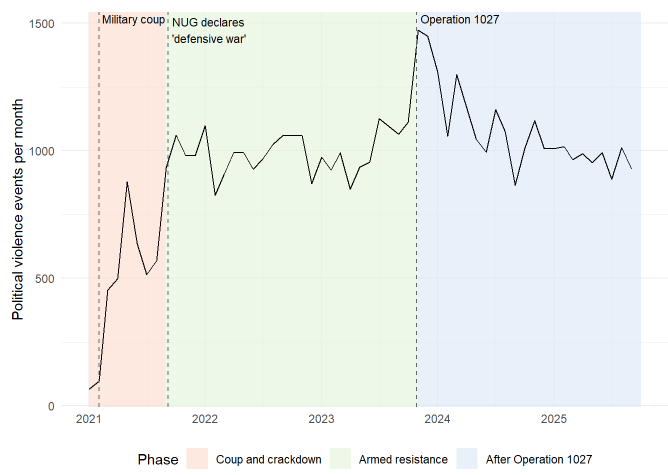
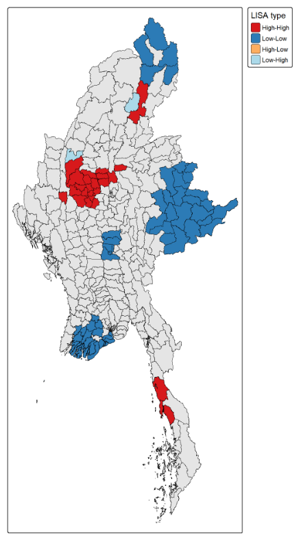
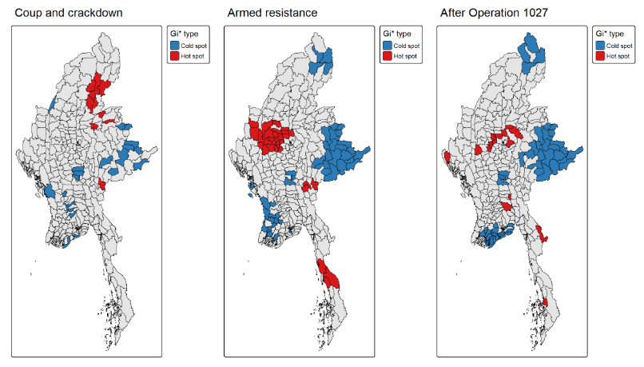
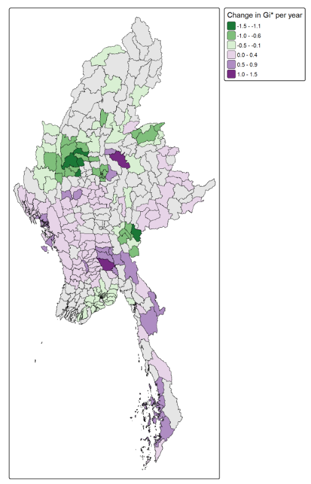
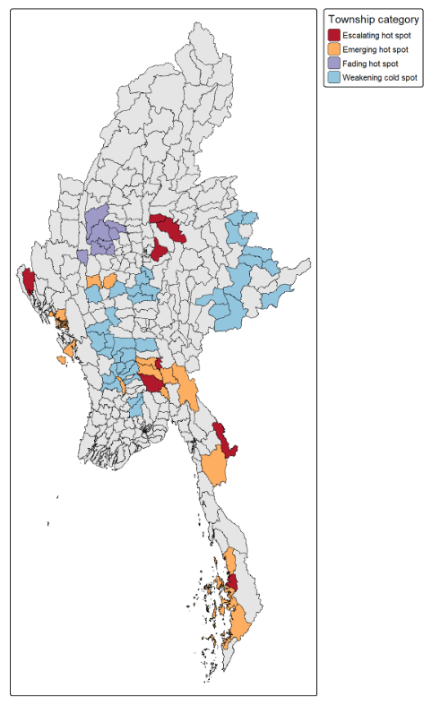

## Content Page {.center}

- Overview
- Research Questions & Objectives
- Study Area & Data
- Analytical Approach
- Key Finding 1: Violence Is Clustered
- Key Finding 2: Hot Spots Have Shifted
- Key Finding 3: Where Violence Is Rising and Fading
- Key Finding 4: Four Conflict Profiles
- Peace-Building Implications
- Limitations & Conclusion

## 1. Overview

- Armed conflict in Myanmar dates back to independence in 1948, mainly between ethnic armed organisations and the military
- The **February 2021 coup** and the violent repression of protests intensified the conflict, as many civilians joined armed resistance and large areas slipped out of the military's control
- Violence since 2021 has therefore been **uneven across the country**
- Understanding **where** violence concentrates, and **how it is changing**, can help guide peace-building efforts

::: notes
Myanmar has endured one of the world's longest-running civil wars. It dates back to the country's independence in 1948, and has largely been fought between ethnic armed organisations and the national military over self-determination and the federalisation of the country.

However, in February 2021, the military seized power from the elected government. The violent repression of protests that followed intensified the conflict rather than ending it. Many civilians joined armed resistance, and large parts of the country slipped out of the military's control.

As a result, violence since 2021 has been uneven across the country. Some areas have seen intense and sustained fighting, while others have remained relatively quiet. This makes the question of where violence concentrates, and how that pattern is changing over time, a spatial one, and answering it can help guide where peace-building and conflict prevention efforts should focus.
:::

## 2. Research Questions

1.  Is political violence spatially clustered across townships, or distributed randomly?
2.  Which townships are significant hot spots, cold spots or spatial outliers?
3.  Where is political violence intensifying, persisting or fading, how fast, and in what pattern?
4.  What do these patterns imply for peace-building and conflict prevention?

::: notes
This study aims to pinpoint where political violence concentrates across Myanmar's townships, and to reveal how that pattern is evolving over time. It is guided by four research questions.

First, whether political violence is spatially clustered across Myanmar's townships, or simply distributed at random. Second, which specific townships are statistically significant hot spots, cold spots or spatial outliers. Third, where violence is intensifying, persisting or fading, how fast this is happening, and in what pattern. And finally, what these patterns imply for peace-building and conflict prevention.
:::

## 3. Study Area & Data

**Study Area:** Myanmar, 330 townships

**Study Period:** January 2021 to September 2025

**Data:** 54,284 political violence events from **ACLED**, mapped to **Myanmar Township Boundaries**, and analysed across three distinct conflict phases

{fig-align="center" width="80%"}

::: notes
The study area is Myanmar, analysed at the township-level, over a study period from January 2021 to September 2025.

Two datasets were used. Event-level records were obtained from ACLED, and township boundaries from the Myanmar Information Management Unit (MIMU). Following ACLED's own definition, only events classified as political violence were kept, giving a final total of 54,284 events after cleaning and matching each event to its township.

To capture how the conflict developed, the study period was divided into three phases, shown by the shaded areas in the chart. The first phase, the coup and crackdown, covers January to August 2021, from the military coup through the repression of protests. The second phase, the armed resistance, begins in September 2021, when the National Unity Government declared a "people's defensive war" against the military, and runs until October 2023. The third phase begins in November 2023, after the launch of Operation 1027, a major coordinated offensive against the military, and continues to the end of the study period.

As the chart shows, violence intensified across these phases. Monthly events rose from an average of around 460 during the coup and crackdown, to around 990 during the armed resistance, and around 1,080 after Operation 1027, peaking in November 2023, shortly after the offensive began.
:::

## 4. Analytical Approach

- **Data Preparation:** match each ACLED event to its township and aggregate by month into a space-time cube
- **Global Spatial Autocorrelation:** test for clustering across the whole country (Global Moran's I)
- **Local Spatial Association:** identify clusters, outliers, hot spots and cold spots, for the whole period and for each conflict phase (Local Moran's I, Gi\*)
- **Emerging Hot Spot Analysis:** detect where violence is rising or falling over time, and how fast (Mann-Kendall test, Sen's slope)
- **Combining the Evidence:** group townships into four categories based on their current situation and trend

::: notes
The analysis followed five main stages.

First, the ACLED events were cleaned, matched to the township they fall in, and counted by township and month, forming a space-time cube of 330 townships over 57 months.

Second, Global Moran's I was used to test whether political violence is clustered across the country as a whole, or distributed at random.

Third, two local measures were applied to locate the clusters. Local Moran's I identifies clusters of similar townships and outliers that differ from their neighbours, while Getis-Ord Gi* identifies hot spots and cold spots. Gi* was also computed separately for each conflict phase, to see how the hot spots moved as the conflict developed.

Fourth, Emerging Hot Spot Analysis calculated Gi* for every township in every month, and used the Mann-Kendall test to detect whether each township's values were consistently rising or falling. Sen's slope was then used to measure how fast each trend is changing.

Finally, the results were combined to group townships into four categories, describing their current situation and where violence is heading.
:::

## 5. Key Finding 1: Violence Is Clustered

:::: {.columns}
::: {.column width="60%"}
- Political violence is **strongly clustered**, not random (Global Moran's I = **0.450**, p \< 0.05)
- **High-High clusters (25 townships):** mainly in **Sagaing**, extending into Magway and Mandalay
- **Low-Low clusters (61 townships):** mainly in **Shan**, **Yangon** and **Ayeyarwady**
- **Low-High outliers (2 townships):** Mogaung and Kalewa, quiet townships surrounded by heavy conflict
:::

::: {.column width="40%"}
{fig-align="center" width="70%"}
:::
::::

::: notes
The first key finding is that political violence in Myanmar is strongly clustered. The Global Moran's I statistic of 0.450 is well above what would be expected under a random pattern, and is statistically significant. In other words, townships with high levels of violence tend to lie next to other high-violence townships, and quiet townships next to other quiet ones.

The map, from the Local Moran's I analysis, shows where these clusters are. The red High-High clusters, where high violence is surrounded by high violence, cover 25 townships. 15 of these are in Sagaing, forming one large cluster that extends into neighbouring Magway and Mandalay, with a smaller group in Tanintharyi in the south.

The blue Low-Low clusters, where quiet townships are surrounded by other quiet townships, are more widespread, covering 61 townships, mainly in Shan in the east, and in Yangon and Ayeyarwady in the south-west.

Two townships stand out as spatial outliers: Mogaung in Kachin and Kalewa in Sagaing. Both record relatively few events, but are surrounded by neighbours with much higher levels of violence, which makes them areas to watch.
:::

## 6. Key Finding 2: Hot Spots Have Shifted

- **Coup and Crackdown:** hot spots mainly in **Kachin, Shan (North) and Kayah (9 townships)**
- **Armed Resistance:** hot spots formed one compact cluster in **Sagaing (16 townships)**
- **After Operation 1027:** hot spots in Sagaing shrank **(5 townships)**, while new hot spots appeared in **Bago (East), Kayin and Rakhine**

{fig-align="center" width="90%"}

::: notes
The second key finding is that the hot spots have moved over time. To see this, Getis-Ord Gi* was computed separately for each of the three conflict phases.

During the coup and crackdown, hot spots appear mainly in Kachin, northern Shan and Kayah.

During the armed resistance, the picture changes. A large, compact cluster of hot spots forms in the north-west and upper centre, with 16 townships in Sagaing alone, together with a smaller group along the southern strip.

After Operation 1027, the Sagaing cluster shrinks to just 5 townships, and the remaining hot spots are smaller and more scattered. Some lie in the upper centre, in Mandalay, Magway and northern Shan, while others appear for the first time in Bago (East), Kayin and Rakhine. 

Interestingly, the number of hot spots falls from 31 to 16 in this phase, even though violence is at its most intense. This is because violence has become so widespread that fewer townships stand out above the rising national average. At the same time, cold spots grow steadily, consolidating into one large block in the east and a growing area in the south.
:::

## 7. Key Finding 3: Rising and Fading Trends

:::: {.columns}
::: {.column width="60%"}
- **98 townships** show a significant rising trend and **105** a falling one
- No township is a persistent or intensifying hot spot
- **Fastest decline:** the former hot spot cluster in **Sagaing**, led by Budalin (-1.30 per year)
- **Fastest rise:** scattered townships such as **Kyaukme** (+1.07 per year)
:::

::: {.column width="40%"}
{fig-align="center" width="80%"}
:::
::::

::: notes
The third key finding looks at how political violence is changing over time. Emerging Hot Spot Analysis calculated the Gi* value of every township in every month, and the Mann-Kendall test checked whether each township's values were consistently rising or falling. Among the 330 townships, 98 show a significant rising trend and 105 a significant falling one.

Over the entire study period, no township is a persistent or intensifying hot spot. Most hot spots are oscillating or sporadic, meaning they become hot in some months but do not stay that way.

To measure how fast these changes happen, Sen's slope was calculated for each township, giving the change in Gi* per year. The map shows this rate for townships with a significant trend, with purple showing a rising concentration of violence, green a falling one, and darker shades indicating faster change.

The steepest declines form a compact core in the north-west, matching the former hot spot cluster in Sagaing, led by Budalin, where the concentration of violence falls by about 1.3 per year.

In contrast, the steepest increases are scattered across single townships, led by Kyaukme in northern Shan. Six of the ten fastest-rising townships are already hot spots after Operation 1027, which means violence is building fastest where it is already concentrated.
:::

## 8. Key Finding 4: Four Conflict Profiles

:::: {.columns}
::: {.column width="60%"}
| Category | Townships | Examples |
|---|---|---|
| **Escalating hot spot** | 8 | Kyaukme, Kyauktaga |
| **Emerging hot spot** | 15 | Hpapun, Ramree |
| **Fading hot spot** | 8 | Budalin, Salingyi |
| **Weakening cold spot** | 36 | Kyaukpadaung, Nattalin |
:::

::: {.column width="40%"}
{fig-align="center" width="70%"}
:::
::::

::: notes
The fourth key finding brings all of the evidence together. Each township was placed into one of four categories based on whether it is a hot spot after Operation 1027, whether it was a hot spot over the whole period, and whether violence around it is rising or falling.

Escalating hot spots are townships that are hot spots now, and where violence is still rising. There are 8 of these, led by Kyaukme and Kyauktaga.

Emerging hot spots are not yet hot spots, but violence around them is rising quickly. There are 15 of these, mainly in Bago (East), Rakhine and Tanintharyi, such as Hpapun and Ramree. The number of emerging hot spots is nearly double the number of escalating ones.

Fading hot spots are the former hot spots where violence is now falling. There are 8 of these, all in Sagaing and Magway, led by Budalin and Salingyi.

Finally, weakening cold spots are among the calmest townships, but the areas around them are becoming less quiet. This is the largest group, with 36 townships, mainly in Bago (West), Magway and Mandalay, such as Kyaukpadaung and Nattalin.

Together, the map suggests that while the former centre of violence in Sagaing is easing, the calmer areas around it are under growing pressure, and new hot spots are forming elsewhere.
:::

## 9. Peace-Building Implications

| Category | Suggested Focus |
|---|---|
| **Escalating hot spot** | **Protection:** civilian protection and humanitarian access, where need is the greatest and still rising |
| **Emerging hot spot** | **Early warning:** support and local dialogue prepared before violence becomes entrenched |
| **Fading hot spot** | **Recovery:** basic services restored, with monitoring for relapse |
| **Weakening cold spot** | **Prevention:** calm areas kept calm, with nearby violence monitored |

::: notes
Each township category points to a different kind of response.

Escalating hot spots, such as Kyaukme and Kyauktaga, are where the need for civilian protection and humanitarian access is the greatest, and that need is still rising.

Emerging hot spots are where early warning matters most. Support and local dialogue can be prepared before violence becomes entrenched. With 15 townships in this category, there is a clear window of opportunity to intervene early in these areas.

Fading hot spots, such as Budalin and Salingyi, offer the first openings for recovery, such as restoring basic services. However, violence may return, hence these townships should still be monitored.

Weakening cold spots are calm townships that are slowly becoming less calm. Local prevention work can help keep them calm, and violence in nearby townships should be watched.
:::

## 10. Limitations & Conclusion

**Limitations:**

-   **Equal weighting:** every event counts once, regardless of severity, fatalities or population
-   **Sparse monthly data:** half of township-months record no events, so monthly Gi\* values can be noisy
-   **Reporting bias:** low counts may reflect limited reporting rather than genuine calm

**Conclusion:**

-   Political violence in Myanmar is **neither random nor fixed** - it gathers in clusters that move, fade and form again
-   Peace-building should focus on **where violence is heading**, not just its historical footprint

::: notes
There are three main limitations to this study.

First, all political violence events are weighted equally. An armed clash, an air strike and an attack on civilians each add one to a township’s count, regardless of their severity or the number of fatalities. As the counts are also not adjusted for population or township size, the study measures the frequency of violent events rather than their human impact or severity.

Second, the monthly data is sparse. Half of all township-months record no events, which makes the monthly Gi\* values noisy. EHSA classes that depend on month-to-month changes, such as sporadic and oscillating hot or cold spots, are therefore best interpreted alongside the overall trend of each township, not in isolation.

Third, ACLED's data relies on reports from media and other sources. Townships with restricted access or limited local reporting may show fewer events than actually occurred. Hence, some townships classified as quiet may simply be due to under-reporting instead of a genuine absence of violence.

In conclusion, political violence in Myanmar is neither random nor fixed. It gathers in clear clusters, but these clusters move, fade and form again over time. Peace-building therefore needs to be adaptive and focus on where violence is heading.
:::
