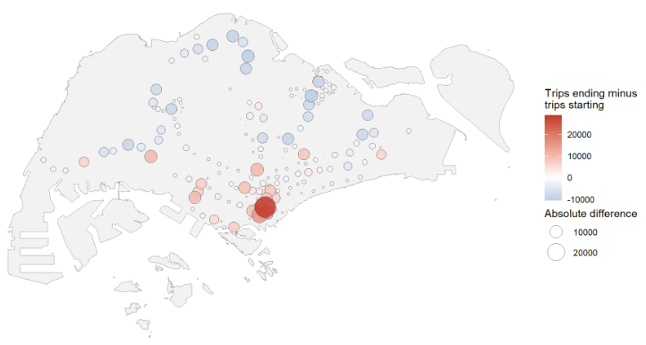
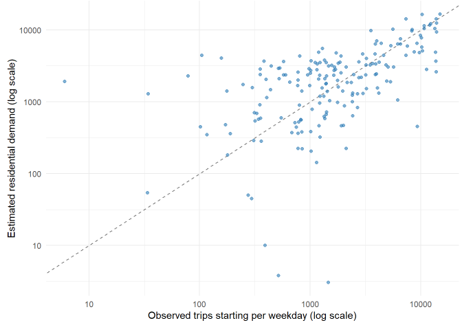
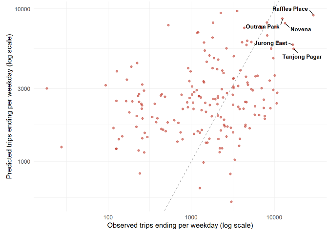
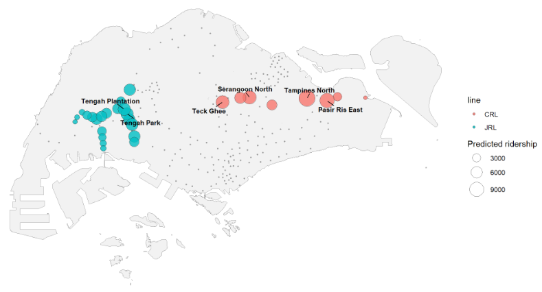
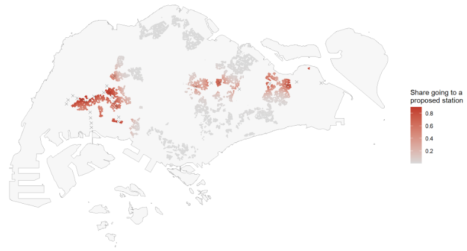
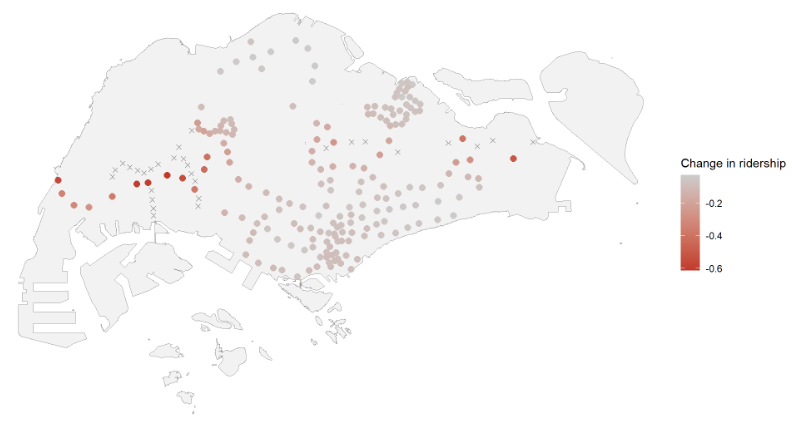
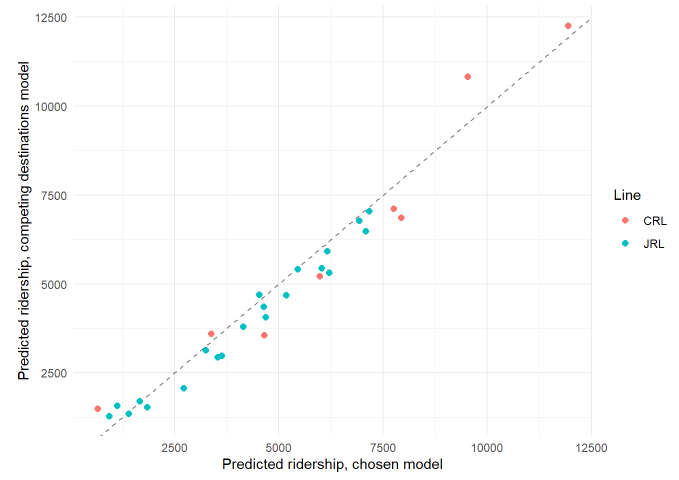

## Content Page {.center}

- Overview
- Research Questions
- Study Area & Data
- Analytical Approach
- Model Performance
- Key Finding 1: The New Stations Are Ordinary in Size
- Key Finding 2: Market Areas Shift in Three Places
- Key Finding 3: Every Existing Station Loses Riders
- Limitations
- Conclusion & Implications

## 1. Overview

- The MRT has been the backbone of public transport in Singapore since 1987, carrying **3.49 million trips a day** in 2025
- The **Land Transport Master Plan 2040** targets a 360 km rail network and 8 in 10 households within a 10-minute walk of a station, both by 2030
- Stations are sometimes **built ahead of demand**, and some open years after their station boxes are completed
- Two lines are being delivered: the **Jurong Region Line (24 stations)** and **Cross Island Line Phase 1 (12 stations)**
- Knowing **which new stations will be busy**, and **which existing stations lose riders**, supports these decisions before the lines open

::: notes
Rail is the backbone of public transport in Singapore. The MRT has been running since 1987, and in 2025 it carried an average of 3.49 million trips a day.

The network is still growing. The Land Transport Master Plan 2040 sets two targets for 2030: a rail network of 360 kilometres, and eight in ten households within a ten-minute walk of a train station.

Stations are sometimes built ahead of the demand for them, to avoid disruptive construction later. Hume station on the Downtown Line is an example. Its station box was built during the second phase of the line, but the station itself only opened in February 2025.

Two further lines are being delivered now. The Jurong Region Line has 24 stations, with Stage 1 expected around mid-2028. Cross Island Line Phase 1 has 12 stations and is targeted to open in 2030.

That raises a planning question. Before these lines open, it is useful to know which of the new stations will be busy, and which existing stations will lose riders to them. This exercise answers that question with a spatial interaction model.
:::

## 2. Research Questions

1.  Which attraction variables, and which distance decay, explain station-level ridership on the existing network?
2.  Does the calibrated model outperform reference models, namely equal market shares and a Huff model with fixed parameters?
3.  What ridership is predicted for each proposed station, and how does it compare with existing stations on the same lines?
4.  Which existing stations lose market share and ridership to the new stations, and where are the losses concentrated?

::: notes
The exercise is guided by four research questions, which follow the three objectives set out in the brief.

The first two concern the model itself. Which attraction variables, and which shape of distance decay, explain how many trips end at a station. And whether a model calibrated on observed flows does better than two reference models: one that gives every destination an equal share, and a Huff model with the exponents fixed rather than estimated.

The third question is the prediction. How many trips each of the proposed stations is expected to carry, and how that compares with the stations already on the network.

The fourth is the impact. Which existing stations lose market share and ridership once the new stations open, and where those losses are concentrated.

Underlying all four is the idea of a market area. Ridership at a station depends on the people who live within reach, the activities the area offers, and the competing stations nearby. A new station changes that competitive position for every station around it.
:::

## 3. Study Area & Data

:::: {.columns}
::: {.column width="45%"}
**Study area**

- **213 stations**: 184 existing, 29 new

**Study period**

- Weekday morning peak, 7 and 8 am
- July to September 2026
- **570,993 trips** per weekday

**Data**

- LTA DataMall, Master Plan 2025
- HDB footprints, bus stops, OpenStreetMap facilities
- **800 m** catchment per station
:::

::: {.column width="55%"}

Blue stations send riders out, red stations receive them
:::
::::

::: notes
The study area is Singapore's MRT and LRT network, covering 213 stations: the 184 operating today and the 29 new stations of the two proposed lines.

The brief names 36 stations across the two lines, 24 on the Jurong Region Line and 12 on Cross Island Line Phase 1. Seven of those are interchanges with stations that already exist, such as Jurong East and Pasir Ris. Those seven are counted once, as existing stations, which leaves 29 genuinely new stations to predict.

The study period is the weekday morning peak, taken as the hours beginning at 7 and 8 am, over July to September 2026. The three months are pooled and divided by the 65 weekdays they contain, giving an average of 570,993 trips per weekday. Those trips run between 33,672 pairs of existing stations, and those pairs are what the model is calibrated on.

Six datasets are used. The origin-destination flows, the existing station locations and the bus stops come from LTA DataMall. The planned stations come from the Master Plan 2025 rail station layer. HDB building footprints measure how many residents live near each station, with 13,436 buildings in total. OpenStreetMap supplies 937 education, retail and health facilities. Each is counted within 800 metres of a station, the half-mile circle used as a walking catchment in transit research.

The map shows the pattern the model has to reproduce. Each circle is the difference between the trips ending and the trips starting at a station. The blue stations in the north and north-east send more riders out than they receive, and these are the housing towns. The red stations in the south centre receive far more than they send. The largest of them is Raffles Place, which takes 29,622 trips on an average weekday.
:::

## 4. Analytical Approach

:::: {.columns}
::: {.column width="50%"}
- The trips starting at a station are divided among all other stations by **attraction** and **distance**, using the **Huff** and **Multiplicative Competitive Interaction (MCI)** models
- **Nine models** compared on 33,672 pairs
- Chosen: **bus stops, education, retail, health** and the **distance to the city centre**, with an exponential decay of **0.109 per km**
- New stations have no riders to observe, so **13,436 HDB buildings are shared among competing stations**
:::

::: {.column width="50%"}

Estimated residential demand against observed trips starting
:::
::::

::: notes
The method is a probabilistic spatial interaction model. For every station where trips start, the model divides those trips among all the other stations. The share going to a particular destination depends on how attractive that destination is and how far away it is.

Two forms are used. The Huff model combines a single measure of attraction with a distance decay. The Multiplicative Competitive Interaction model extends this by giving each attraction variable its own exponent, estimated from observed flows.

Nine models were compared, starting from one that gives every destination an equal share. The chosen model uses four attraction variables counted within the catchment, together with the distance to the city centre, which stands in for jobs, since nothing in the data counts them. A decay of 0.109 for each kilometre means a destination loses about a tenth of its pull per extra kilometre.

A proposed station has no observed trips, so its demand has to be estimated. Each HDB building is shared among the stations around it by a Huff model: a building close to one station gives most of its area to that station, and a building between two stations splits between them. The rate of decay is calibrated against the observed trips starting at the existing stations, and the plot shows the result, with each point an existing station.

The assignment is then run twice, once over the 184 existing stations and once over all 213. The difference gives the riders each new station takes from the stations around it.
:::

## 5. Model Performance

:::: {.columns}
::: {.column width="50%"}
- The chosen model explains **22%** of the variation in arrivals, against 4% for equal shares and under 1% for a calibrated Huff model
- It **holds up out of sample**: five-fold validation by origin gives the same 22%
- Estimated residential demand correlates **0.744** with observed trips starting, against 0.39 for a simple catchment count
- But predictions are **pulled towards the middle**: the quietest quarter of stations is over-predicted about nine times, the busiest under-predicted by half
:::

::: {.column width="50%"}

Predicted against observed arrivals, 184 existing stations
:::
::::

::: notes
The chosen model explains 22% of the variation in the trips ending at a station. That is a large improvement on the reference models: equal shares explains 4%, and a Huff model with calibrated exponents but a single attraction variable explains under 1%. The two largest gains came from giving each attraction variable its own exponent, and from adding the distance to the city centre.

The model also generalises. The origins were split into five groups, and each group in turn was predicted by a model fitted on the other four. The out-of-sample result is the same as the in-sample one, which means the parameters are not fitted to noise.

On the origin side, sharing the HDB buildings among competing stations matches the observed trips starting with a correlation of 0.744. Simply counting HDB area inside an 800 metre catchment gives 0.39, because that count ignores competition between nearby stations and counts the same building for every station within reach.

The caveat is visible in the plot. The cloud of points is flatter than the dashed line. Stations with few observed arrivals sit above it, where the model predicts too many, and busy stations sit below it, where it predicts too few. This is why the predicted figures should be read as the scale of a station's ridership rather than a forecast, and why the quietest of the proposed stations are likely to be over-predicted.
:::

## 6. Key Finding 1: The New Stations Are Ordinary in Size

:::: {.columns}
::: {.column width="50%"}
- **140,169 trips per weekday**, about **12%** of the network's ridership today
- **Jurong Region Line**: 21 stations, 88,333 trips. **Cross Island Line**: 8 stations, 51,835 trips
- Busiest: **Tampines North (11,936 trips)**. Quietest: **Aviation Park (656)**
- Median new station **4,654 trips**, against **4,803** at the existing stations
:::

::: {.column width="50%"}

Predicted ridership of the 29 proposed stations
:::
::::

::: notes
Applied to the proposed network, the model gives the 29 new stations 140,169 trips per weekday in the morning peak, about 12% of the ridership of the network as it stands.

The Jurong Region Line accounts for 88,333 of those trips across its 21 new stations, and Cross Island Line Phase 1 for 51,835 across its 8. The Cross Island Line has fewer stations but each one is busier: its median station is predicted 6,871 trips against 4,528 on the Jurong Region Line.

The four busiest stations of the 29 are all on the Cross Island Line, and all lie in built-up housing areas: Tampines North, Pasir Ris East, Serangoon North and Teck Ghee.

The quietest are in the west and the far east. Several Jurong Region Line stations in industrial areas, such as Jurong Pier and Tukang, are predicted to receive more trips than they send, because they sit among workplaces rather than housing.

The headline is the last point. In ridership terms these are ordinary stations, not major ones.
:::

## 7. Key Finding 2: Market Areas Shift in Three Places

:::: {.columns}
::: {.column width="50%"}
- **2,112 HDB buildings**, holding **16.1%** of the island's HDB footprint area, move closer to a new station
- Three groups: **Tengah and Jurong**, the **centre**, and **Tampines and Pasir Ris**
- **Pasir Ris** loses 330 buildings. **Tampines North** gains 275
- Elsewhere little changes: the median building sends **1%** of its area to a new station
:::

::: {.column width="50%"}

Red buildings move to a new station
:::
::::

::: notes
This slide explains why the next one looks as it does. Each HDB building is shared among the stations by the Huff model, and the map colours every building by the share of its area going to one of the 29 new stations. Grey means almost none, red means most of it.

2,112 buildings end up closer to a new station than to any existing one. They hold 16.1% of the island's HDB footprint area, so roughly a sixth of public housing changes hands in market area terms.

The affected housing forms three groups: the west around Tengah and Jurong, the centre along the middle of the Cross Island Line, and the east around Tampines and Pasir Ris.

Pasir Ris loses the most buildings, 330 of them, mostly to Pasir Ris East and Tampines North. Tampines North gains the most, at 275, followed by Pasir Ris East at 265 and Serangoon North at 233. Those are the same three stations with the highest predicted ridership on the previous slide, which shows their predictions rest on the residential area they take over.

The rest of the island is largely untouched, so the effect is concentrated rather than general.
:::

## 8. Key Finding 3: Every Existing Station Loses Riders

:::: {.columns}
::: {.column width="50%"}
- Ridership at the existing stations falls from **1,141,986** to **1,001,817 trips per weekday**
- The median station loses **7.9%**, and **no station gains**
- **51 stations** lose more than a tenth of their ridership, and **16** lose more than a quarter
- Deepest in the west, along the Jurong Region Line: **Lakeside −61%**, Pioneer −60%, Boon Lay −60%
- Least affected in the north: Admiralty, Khatib and Sembawang, each under 3%
:::

::: {.column width="50%"}

Change in ridership at existing stations. Crosses mark the proposed stations
:::
::::

::: notes
The new stations draw their riders from the stations around them. Across the 184 existing stations, ridership falls from 1,141,986 trips per weekday to 1,001,817.

The median station loses 7.9%, and no station gains. That follows from the design: the total number of trips is held constant, so the new stations redistribute trips rather than attract new ones.

The losses are not spread evenly. On the map, the darkest points lie along the western corridor, where the crosses marking the proposed stations are closest together. Lakeside, Pioneer and Boon Lay sit on the East West Line, and the Jurong Region Line runs beside them through the same housing.

A second group lies at the eastern end of the Cross Island Line, where Pasir Ris loses 39%. The least affected stations are in the north, furthest from both new lines.

One figure to treat with care is Changi Airport, at −51%. Its ridership before the new stations is only about 1,950 trips, and its catchment holds almost no HDB housing, which is where the demand estimate is weakest.
:::

## 9. Limitations

:::: {.columns}
::: {.column width="50%"}
- **No data on jobs**, which draw most morning trips. The distance to the city centre is a rough substitute
- Residents measured by **HDB footprints only**, and distances measured in **straight lines**
- Predictions are **pulled towards the middle**, errors **cluster in space**, and total trips are **held constant**
- A **competing destinations** model fits better: it agrees on the new stations (**0.979**) but gives a different median loss (**−4.3%** against **−7.9%**)
:::

::: {.column width="50%"}

Predicted ridership under the two models
:::
::::

::: notes
Four limitations matter most.

First, nothing in the data counts jobs, which are what draw most trips in the morning peak. The distance to the city centre is a rough substitute. This is the single largest source of error: the model predicts about 9,100 trips ending at Raffles Place against 29,622 observed.

Second, the measures are coarse. Residents are counted through HDB building footprints, so private housing is left out and places of work have no measure at all, which is why the three Tuas stations are badly under-estimated. Distance is measured in straight lines, with no rail network, transfers or fares.

Third, the model has two known biases. Predictions are pulled towards the middle of the range, and the residuals still follow a spatial pattern, with a Moran's I of 0.263, which means something systematic is missing. The total number of trips is also held constant, which assumes the new lines attract no additional travel.

Fourth, and this is the value-added test in the report, a competing destinations model that also accounts for how crowded a station's surroundings are fits considerably better. It is not used for the predictions, because its measure of crowding changes when stations are added, which the calibration cannot test. The plot shows the two models agreeing closely on the ridership of the new stations and disagreeing on the impact. The ridership predictions are therefore the firmer result.
:::

## 10. Conclusion & Implications

**Conclusions**

- The 29 new stations are predicted **140,169 trips per weekday**, and the median one is an ordinary station in size
- Their riders come largely from **catchments the network already serves**: a sixth of HDB footprint area changes market area
- **Every existing station loses ridership**, with the deepest losses in the west

**Implications**

- Capacity should be considered first for **Tampines North, Pasir Ris East and Serangoon North**, the three busiest of the new stations
- **Bus services in the west** warrant review, where the Jurong Region Line draws on catchments the existing line serves
- The **ridership predictions are the firmer finding**; the impact figures are indicative

::: notes
Three conclusions follow from the analysis.

The 29 new stations are predicted 140,169 trips per weekday in the morning peak, and the median new station is close to the median existing station in size. These are ordinary stations rather than major ones.

Their riders come largely from catchments the network already serves. A sixth of the island's HDB footprint area moves closer to a new station than to any existing one, and that is what produces the losses.

Every existing station loses ridership, with a median loss of 7.9% and the deepest losses along the western corridor.

Two implications follow for planning. Capacity should be considered first for the three busiest of the new stations, all at the eastern end of the Cross Island Line. Bus services in the west would also be worth reviewing, since they carry residents to Lakeside, Pioneer and Boon Lay, and many of those residents will live closer to a Jurong Region Line station once the new line opens.
:::